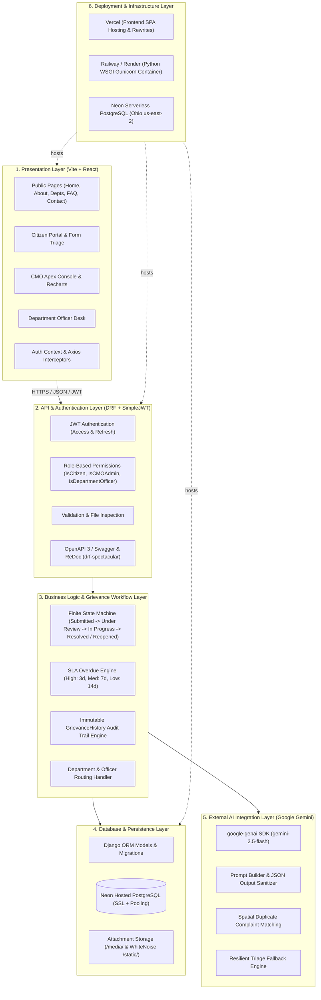

# 02 — System Architecture & Modular Monolith Design

## 1. Modular Monolithic Architecture

CivicFlow uses a clean, modular monolithic architecture with explicit separation of concerns across 6 distinct functional layers. This avoids the operational complexity, network latency, and infrastructure cost of microservices while providing maintainability and domain isolation.

---

## 2. Detailed Architectural Layer Responsibilities

### Layer 1: Presentation Layer
- **Technology**: React 19, Vite, Tailwind CSS, React Router v7, Recharts, Lucide Icons.
- **Responsibilities**:
  - Responsive, accessible user interface adhering to clean government design guidelines (deep emerald green, navy accents, clear visual hierarchy).
  - Client-side route shielding using `ProtectedRoute` based on decoded JWT roles (`CITIZEN`, `CMO_ADMIN`, `DEPARTMENT_OFFICER`).
  - Axios interceptor attaching Bearer tokens and gracefully handling 401 unauthenticated redirects.
  - Interactive charts via Recharts for district distributions and priority splits.

### Layer 2: API and Authentication Layer
- **Technology**: Django REST Framework, SimpleJWT, `drf-spectacular`.
- **Responsibilities**:
  - Issue cryptographically signed HMAC-SHA256 JWT access and refresh tokens.
  - Custom JWT claims providing user email, full name, role, and department metadata.
  - Strict DRF permission classes (`IsCitizen`, `IsCMOAdmin`, `IsDepartmentOfficer`, `IsAdminOrOfficer`).
  - Auto-generated OpenAPI 3.0 schema and interactive Swagger UI at `/api/docs/` and `/api/redoc/`.

### Layer 3: Business Logic and Grievance Workflow Layer
- **Technology**: Django Service Functions, Model Domain Logic.
- **Responsibilities**:
  - Enforce legal grievance transitions: Citizens submit (`Submitted`), CMO routes (`Under Review`), Officers investigate (`In Progress`), Officers file reports, and CMO evaluates resolution (`Resolved` or `Reopened`).
  - Automatic `KL-GRV-XXXXXX` reference number generation.
  - Real-time SLA overdue calculation: High priority = 3 calendar days, Medium = 7 days, Low = 14 days.
  - Immutable audit logging on `GrievanceHistory` capturing every status transition, actor ID, and administrative remark.

### Layer 4: Database and Persistence Layer
- **Technology**: Neon Hosted PostgreSQL, Django ORM, WhiteNoise.
- **Responsibilities**:
  - ACID-compliant transaction safety for grievance state updates and assignments.
  - Foreign key constraints, UUID primary keys, and indexed query fields (`reference_number`, `status`, `priority`, `created_at`).
  - WhiteNoise compressed manifest static files storage for production hosting.

### Layer 5: External AI Integration Layer
- **Technology**: Google Gemini API via official `google-genai` Python SDK (`gemini-2.5-flash`).
- **Responsibilities**:
  - Analyze natural language grievance subjects and descriptions.
  - Predict responsible government department, grievance category, and severity priority.
  - Generate a concise 1–2 sentence executive summary for the CMO desk.
  - Detect potential duplicate complaints from recent neighborhood filings.
  - Resilient fallback engine that gracefully handles network timeouts, rate limits, or invalid keys without interrupting citizen submissions.

### Layer 6: Deployment & Infrastructure Layer
- **Technology**: Vercel, Railway, Render, Neon.
- **Responsibilities**:
  - Frontend SPA hosting with single-page routing rewrites on Vercel.
  - WSGI web process scaling on Railway/Render with Gunicorn and `$PORT` binding.
  - Neon Serverless PostgreSQL with SSL connection pooling.
