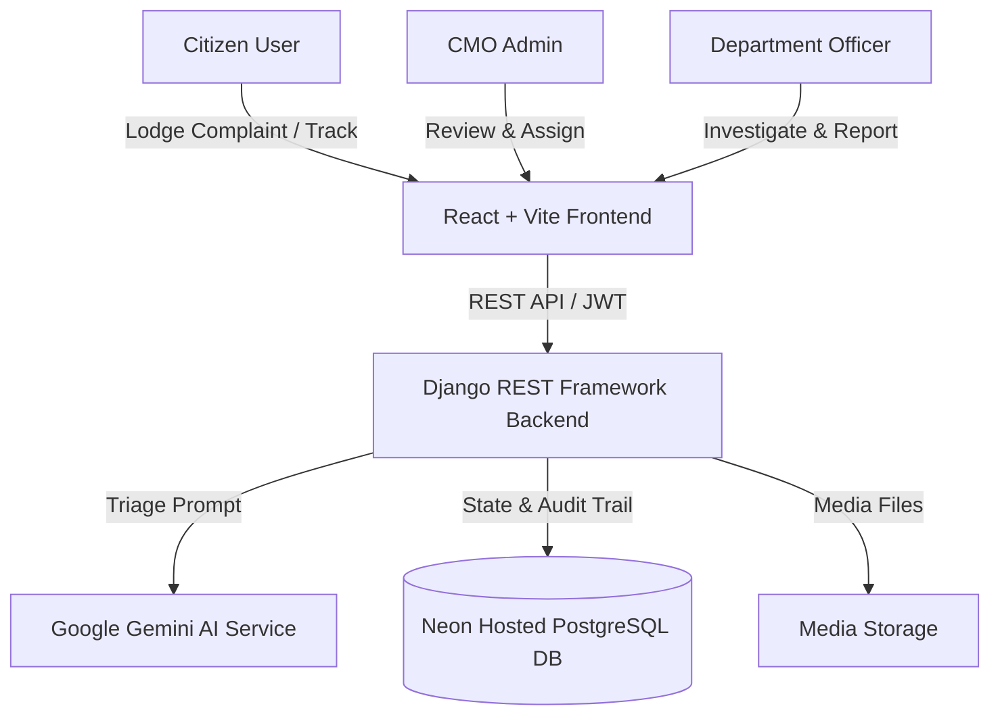

# 02 — System Architecture

### Component Breakdown
1. **Frontend**: React 19, Vite, Tailwind CSS, Lucide Icons, React Router v7, Recharts, Axios.
2. **Backend**: Python 3.13, Django 6.1, Django REST Framework, SimpleJWT, Psycopg2-binary, Dj-Database-URL.
3. **Database**: Hosted Neon PostgreSQL (with connection pooling and SSL).
4. **AI Engine**: Google Gemini API via official `google-genai` SDK with resilient rule-based fallbacks.
