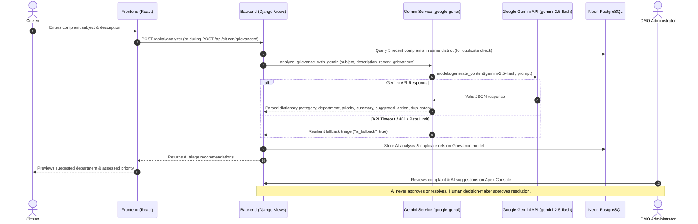

# 05 — AI Integration & Runtime AI Architecture

CivicFlow integrates the official Google Gemini API via `google-genai` SDK on the Django backend.

---

## 1. Runtime AI Architecture Flow



---

## 2. Model & SDK Specification
- **Model**: `gemini-2.5-flash`
- **Official SDK**: `google-genai` (v3.4.0)
- **Engine File**: `backend/api/gemini_service.py`
- **Execution Environment**: Backend server-side only. Client applications never have access to `GEMINI_API_KEY`.

---

## 3. Prompt Design & Output JSON Contract

```json
{
  "category": "Roads & Bridges",
  "suggested_department": "Public Works Department",
  "priority": "High",
  "summary": "Severe pothole cluster in Pattom resulting in road safety hazards.",
  "suggested_action": "Dispatch PWD road maintenance quick-response crew for cold-mix bitumen patching.",
  "potential_duplicate_refs": ["KL-GRV-DEMO01"]
}
```

---

## 4. Duplicate Complaint Detection Strategy
When a citizen initiates grievance analysis:
1. The backend inspects the active district and queries up to 5 of the most recent grievances logged in that district.
2. The subjects and brief summaries are appended to the Gemini prompt context.
3. Gemini evaluates whether the new description refers to the exact same physical hazard, street, or public facility.
4. Any matching reference numbers are stored in the `potential_duplicates` JSON field.
5. In the **CMO Apex Console**, an amber **"Potential Duplicate Alert"** card is surfaced, prompting the administrative reviewer to cross-check rather than sending multiple inspection crews to the same location.

---

## 5. Security & Human Safeguards
1. **Human-in-the-Loop Enforced**: AI cannot independently approve, reject, assign, or close grievances. Official administrative actions are reserved exclusively for authenticated CMO Administrators and Department Officers.
2. **Credential Isolation**: The Gemini API key is managed via server environment variables (`.env`) and never sent across the client wire.
3. **Resilient Fallback Mode**: If Gemini returns an authentication error (e.g., key expired), quota limit, or network timeout, the application logs the exception and returns a standard operational fallback triage with `"is_fallback": true`. Citizen submissions are never blocked or lost due to external AI downtime.
