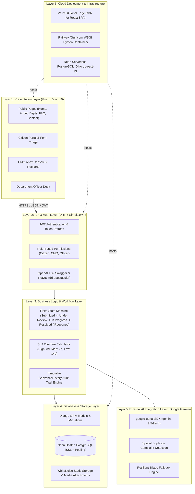
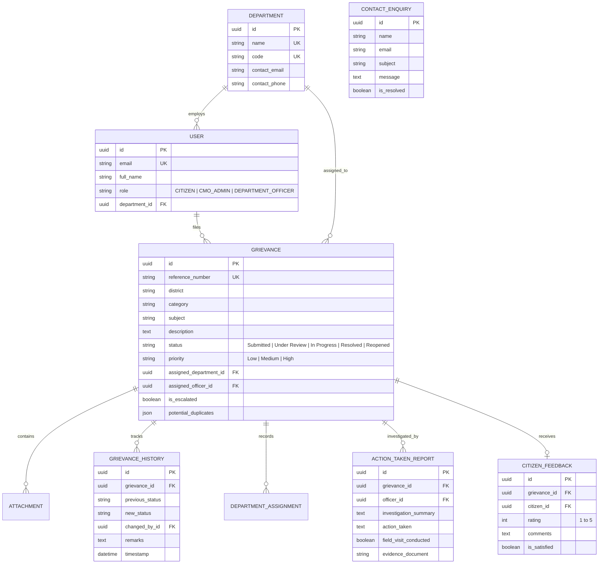

# CivicFlow — Project Wiki & Master Documentation Index

Welcome to the **CivicFlow** project documentation wiki. This index aggregates the complete architectural, database, API, AI integration, compliance, and user operations guides into a single reference handbook.

---

## 📑 Wiki Table of Contents

1. [Project Overview & Core Mission](#1-project-overview--core-mission)
2. [Live Application & Demonstration Access](#2-live-application--demonstration-access)
3. [6-Layer Modular Monolithic Architecture](#3-6-layer-modular-monolithic-architecture)
4. [Database Schema & ER Design](#4-database-schema--er-design)
5. [Complete 10-Step Grievance Workflow](#5-complete-10-step-grievance-workflow)
6. [API Specification & Swagger Explorer](#6-api-specification--swagger-explorer)
7. [Runtime Gemini AI Architecture](#7-runtime-gemini-ai-architecture)
8. [Service Level Agreements (SLA) & Overdue Rules](#8-service-level-agreements-sla--overdue-rules)
9. [Role-Based Access Control (RBAC) & Security](#9-role-based-access-control-rbac--security)
10. [AI Development Tools & Engineering Workflow Disclosure](#10-ai-development-tools--engineering-workflow-disclosure)
11. [Testing & Verification Suite](#11-testing--verification-suite)
12. [Deployment & Infrastructure Topology](#12-deployment--infrastructure-topology)

---

## 1. Project Overview & Core Mission
Detailed reference: [01_Project_Overview.md](file:///DOCUMENTATION/01_Project_Overview.md)

**CivicFlow** is an enterprise-grade public grievance redressal platform engineered for centralized civic administration across Kerala's 14 districts. It allows citizens to lodge complaints regarding public infrastructure, health, water supply, electricity, and transport. Every submission is analyzed in real-time by Google Gemini AI, reviewed by the Chief Minister’s Office (CMO), routed to designated field officers, and verified through citizen post-resolution feedback.

> **Disclaimer**: CivicFlow is an independent recruitment demonstration prototype created for technical evaluation. It is not officially affiliated with or endorsed by the Government of Kerala.

---

## 2. Live Application & Demonstration Access

- **Frontend Application (Vercel CDN)**: [https://civicflow-v1.vercel.app/](https://civicflow-v1.vercel.app/)
- **Backend API & Swagger UI (Railway)**: [https://civicflow-backend-production.up.railway.app/api/docs/](https://civicflow-backend-production.up.railway.app/api/docs/)
- **ReDoc API Reference (Railway)**: [https://civicflow-backend-production.up.railway.app/api/redoc/](https://civicflow-backend-production.up.railway.app/api/redoc/)
- **Streamable Walkthrough Video**: [https://civicflow-v1.vercel.app/demo-walkthrough.mp4](https://civicflow-v1.vercel.app/demo-walkthrough.mp4)

### Demonstration User Accounts (Pre-Seeded in Neon DB)
All demonstration accounts share the unified password: **`qwertyuiop1234567890`**

| Role | Username / Email | Password | Scope & Responsibilities |
|---|---|---|---|
| **CMO Administrator** | `cmo.admin@civicflow.gov.in` | `qwertyuiop1234567890` | **Apex Console**: State-wide KPI analytics, SLA overdue tracking, department/officer assignment, case escalations, resolution approvals |
| **PWD Department Officer** | `officer.pwd@civicflow.gov.in` | `qwertyuiop1234567890` | **Officer Desk**: Public Works complaints, status updates (*In Progress*), Action-Taken Report submissions with inspection evidence |
| **KWA Department Officer** | `officer.kwa@civicflow.gov.in` | `qwertyuiop1234567890` | **Officer Desk**: Kerala Water Authority complaints & field inspection reporting |
| **Citizen User** | `citizen.rajesh@gmail.com` | `qwertyuiop1234567890` | **Citizen Portal**: File complaints, live AI triage preview, status history, 1–5 star resolution satisfaction feedback |

*(Note: The login page at `/login` provides 1-click quick-fill buttons for evaluator convenience).*

---

## 3. 6-Layer Modular Monolithic Architecture
Detailed reference: [02_System_Architecture.md](file:///DOCUMENTATION/02_System_Architecture.md)

---

## 4. Database Schema & ER Design
Detailed reference: [03_Database_Design.md](file:///DOCUMENTATION/03_Database_Design.md)

The database schema is implemented with 9 normalized relational models on PostgreSQL:

---

## 5. Complete 10-Step Grievance Workflow
Detailed reference: [07_User_Guide.md](file:///DOCUMENTATION/07_User_Guide.md)

Every grievance follows an enforceable, auditable finite state transition:

1. **Citizen Submission**: Citizen inputs district, category, subject, description, and optional photo.
2. **Unique Reference Generation**: System issues `KL-GRV-XXXXXX` reference number.
3. **AI Triage & Duplicate Check**: Gemini analyzes text, recommends department & priority, and flags duplicates.
4. **CMO Review**: Chief Minister’s Office reviews complaint on the Apex Console.
5. **Department & Officer Routing**: CMO assigns case to specific department and designated officer.
6. **Field Investigation**: Officer updates status to `In Progress` and conducts physical inspection.
7. **Action-Taken Report**: Officer files formal ATR detailing remedial measures and attaching evidence.
8. **CMO Verification**: CMO inspects ATR and officially sets status to `Resolved` or `Reopened`.
9. **Public Transparency**: Audit trail is updated in real-time on the public tracking portal.
10. **Citizen Satisfaction Feedback**: Citizen rates completed work (1–5 stars) and submits feedback comments.

---

## 6. API Specification & Swagger Explorer
Detailed reference: [04_API_Documentation.md](file:///DOCUMENTATION/04_API_Documentation.md)

- **Interactive Swagger UI**: [https://civicflow-backend-production.up.railway.app/api/docs/](https://civicflow-backend-production.up.railway.app/api/docs/)
- **Interactive ReDoc**: [https://civicflow-backend-production.up.railway.app/api/redoc/](https://civicflow-backend-production.up.railway.app/api/redoc/)
- **Raw OpenAPI Schema**: [https://civicflow-backend-production.up.railway.app/api/schema/](https://civicflow-backend-production.up.railway.app/api/schema/)

### Core Endpoint Map
| Method | Endpoint | Description | Permission |
|---|---|---|---|
| `POST` | `/api/auth/register/` | Register citizen account | Public |
| `POST` | `/api/auth/login/` | Obtain JWT access and refresh tokens | Public |
| `POST` | `/api/auth/token/refresh/` | Refresh expired JWT access token | Public |
| `GET` | `/api/auth/me/` | Fetch current user profile & role | Authenticated |
| `GET` | `/api/departments/` | List all government departments | Public |
| `POST` | `/api/contact/` | Submit enquiry (persisted in DB) | Public |
| `GET` | `/api/grievances/track/<ref>/` | Privacy-safe tracking by reference number | Public |
| `POST` | `/api/ai/analyze/` | Real-time complaint analysis & duplicate triage | Authenticated |
| `GET` | `/api/citizen/grievances/` | List citizen's filed complaints | Citizen |
| `POST` | `/api/citizen/grievances/` | Submit complaint with AI triage | Citizen |
| `GET` | `/api/citizen/grievances/<id>/` | View complete grievance details | Citizen |
| `POST` | `/api/grievances/<id>/attachments/` | Upload supporting document/photo (max 10MB) | Citizen / Admin |
| `POST` | `/api/grievances/<id>/feedback/` | Submit 1–5 star resolution rating | Citizen |
| `GET` | `/api/cmo/stats/` | Live state-wide KPI statistics & SLA overdue counts | CMO Admin |
| `GET` | `/api/cmo/grievances/` | Multi-filter grievances list (`?overdue=true`) | CMO Admin |
| `POST` | `/api/cmo/grievances/<id>/assign/` | Route case to department & officer | CMO Admin |
| `POST` | `/api/cmo/grievances/<id>/status/` | Approve resolution or reopen case | CMO Admin |
| `POST` | `/api/cmo/grievances/<id>/escalate/` | Escalate overdue case to High priority | CMO Admin |
| `GET` | `/api/officer/grievances/` | List department-assigned cases | Officer |
| `POST` | `/api/officer/grievances/<id>/status/` | Update progress status (`In Progress`) | Officer |
| `POST` | `/api/officer/grievances/<id>/action-report/` | Submit Action-Taken Report with evidence | Officer |

---

## 7. Runtime Gemini AI Architecture
Detailed reference: [05_AI_Integration.md](file:///DOCUMENTATION/05_AI_Integration.md)

- **Model**: `gemini-2.5-flash` via official `google-genai` Python SDK.
- **Contract**: Structured JSON returning `category`, `suggested_department`, `priority`, `summary`, `suggested_action`, and `potential_duplicate_refs`.
- **Duplicate Detection**: Queries up to 5 recent complaints in the same district and evaluates spatial or physical overlap.
- **Human Safeguard**: AI never independently approves, rejects, or resolves cases.
- **Resilient Fallback**: Tested against API errors, timeouts, or quota limits; automatically provides operational fallback triage tagged `"is_fallback": true`.

---

## 8. Service Level Agreements (SLA) & Overdue Rules
CivicFlow enforces time-bound resolution windows based on assessed priority:

- **High Priority**: **3 Calendar Days** (urgent hazards, road cave-ins, water contamination)
- **Medium Priority**: **7 Calendar Days** (general road patching, streetlight outages, drainage blockages)
- **Low Priority**: **14 Calendar Days** (administrative inquiries, non-hazardous maintenance)

The system dynamically computes `Grievance.is_overdue()`:
$$\text{Overdue} = (\text{Status} \neq \text{Resolved}) \land (\text{Now} > \text{Created} + \text{SLA Days})$$
Overdue cases are highlighted with red warning badges and can be filtered on the CMO console with 1-click.

---

## 9. Role-Based Access Control (RBAC) & Security

- **Password Hashing**: Django PBKDF2 with SHA-256 (260,000 iterations).
- **JWT Authentication**: Cryptographically signed access (1-day) and refresh (7-day) tokens.
- **Data Isolation**:
  - Citizens can only query their own grievances (`citizen=request.user`).
  - Officers can only view grievances assigned to their department (`assigned_department=officer.department`).
  - Public tracking hides personal names, phone numbers, emails, and internal remarks.
- **File Security**: Strict 10MB file size limit and MIME-type validation (JPG, PNG, WEBP, PDF).
- **CORS & CSRF**: Fully configured for production between Vercel and Railway.

---

## 10. AI Development Tools & Engineering Workflow Disclosure
Detailed reference: [09_AI_Development_Tools_Disclosure.md](file:///DOCUMENTATION/09_AI_Development_Tools_Disclosure.md)

- **AI Coding Assistants Used**:
  - **Google Antigravity & Gemini Agentic Assistant**: Primary autonomous full-stack coding environment for project scaffolding, models, React components, and atomic Git conventional commits.
  - **Claude Code**: Utilized for architectural reasoning, permission boundary audits, and gap analysis against machine-test specifications.
- **Tools Explicitly Not Used**: Grok CLI, OpenCode, and Mimo Code (evaluated but not used).
- **Runtime AI Integration**: Google Gemini API (`gemini-2.5-flash`) via the official `google-genai` SDK.
- **Third-Party Infrastructure**: Neon (PostgreSQL), Railway / Render (WSGI hosting), Vercel (Edge SPA), and GitHub.

---

## 11. Testing & Verification Suite
Detailed reference: [06_Setup_and_Testing.md](file:///DOCUMENTATION/06_Setup_and_Testing.md) & [08_Compliance_Report.md](file:///DOCUMENTATION/08_Compliance_Report.md)

### Automated Test Suite: `python manage.py test api --keepdb`
1. `test_auth_login`: JWT authentication, claims issuance, and role payload verification.
2. `test_citizen_submit_and_list_grievance`: Creation, `KL-GRV-` reference number generation, and pagination.
3. `test_public_tracking`: Privacy-safe public status tracker (masks citizen sensitive data).
4. `test_cmo_assign_and_status`: CMO department routing and resolution status changes.
5. `test_officer_action_report`: Department officer investigation and action-taken reporting.

**Result**: **5 out of 5 tests passed (Ran 5 tests — OK)**.
**Frontend Build**: `tsc && vite build` completed with zero TypeScript or bundling errors.

---

## 12. Deployment & Infrastructure Topology

- **Frontend Edge CDN**: Vercel (`https://civicflow-v1.vercel.app/`) with client-side SPA rewrites in `frontend/vercel.json`.
- **Backend Application Server**: Railway (`https://civicflow-backend-production.up.railway.app/`) running Python 3.13, Gunicorn WSGI, and WhiteNoise compressed static asset serving configured in `railway.json` and `Procfile`.
- **Production Database**: Neon Serverless PostgreSQL running in AWS us-east-2 with SSL connection pooling.
- **Safe CI/CD Pipeline**: Automated GitHub Actions workflow (`.github/workflows/ci.yml`) performing secrets leak scanning, Django dry-run migration checks, unit tests, and Vite production builds on every push to `main`.
